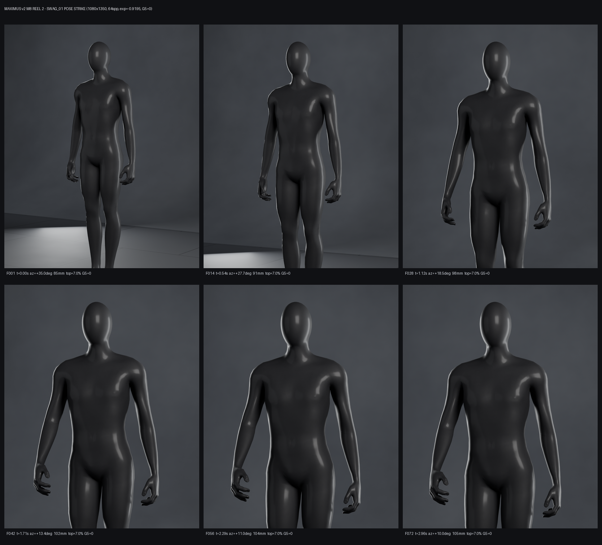
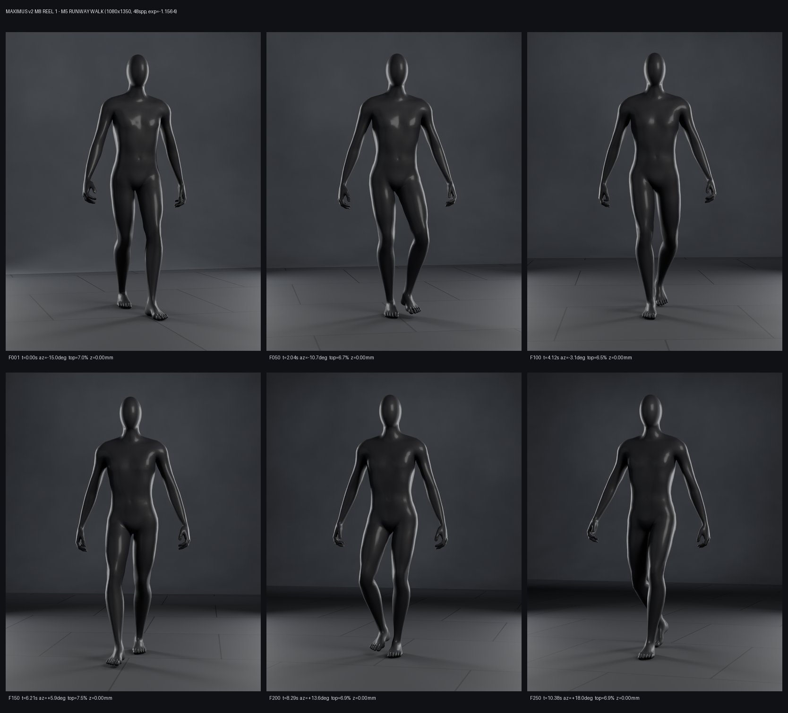

# Maximus v2: headless character rig, pose correctives and game export

A character pipeline in Python and headless Blender for a 152-bone, 13,380-vertex mannequin. The body is MakeHuman-derived. `bpy.ops` calls are confined to one export gateway, and a test enforces it.

**Live demo:** [Maximus Motion Studio](https://better-style-shop.vercel.app/catalogue/#/fitting)

## Visual Proof -> Source Code

### Pose strike, 72 frames, 0 collapsed triangles on every frame

### Procedural runway walk, 250 frames

| Asset | Produced by |
|---|---|
| [`M8_pose_contact_sheet.png`](showcase/M8_pose_contact_sheet.png), [`maximus_v2_pose_strike.mp4`](showcase/maximus_v2_pose_strike.mp4) | [`m8_motion_reels.py`](maximus_engine/colab_stage/m8_motion_reels.py), blending poses P1 and P2 from [`pose_specs.py`](maximus_engine/pipeline/pose_specs.py) |
| [`M8_walk_contact_sheet.png`](showcase/M8_walk_contact_sheet.png), [`maximus_v2_walk_reel.mp4`](showcase/maximus_v2_walk_reel.mp4) | [`m8_motion_reels.py`](maximus_engine/colab_stage/m8_motion_reels.py), from the walk solved by [`m5_anthro_regressor_and_walk.py`](maximus_engine/colab_stage/m5_anthro_regressor_and_walk.py) |
| [`maximus_v2_game_lod1.glb`](showcase/maximus_v2_game_lod1.glb) | [`m6_dual_lod_game_export.py`](maximus_engine/colab_stage/m6_dual_lod_game_export.py) |
| [`maximus_v2_breath_loop.webp`](showcase/maximus_v2_breath_loop.webp) | [`m5_anthro_regressor_and_walk.py`](maximus_engine/colab_stage/m5_anthro_regressor_and_walk.py) |

## What it does
- **Pose correctives.** Linear blend skinning plus Corrective Smooth left collapsed triangles in all 16 test poses. Pose-space shape keys, solved with a small area-restoring repair and driven by RBF weights, bring that to 0 in all 16. Four keys (armpits and hips) were not enough; see `evidence/M4_canon_atlas.json`.
- **Body variation.** Five shape keys for build and leg length, with a regressor.
- **Game export.** The 152-bone rig is folded down to a 24-bone skeleton with at most 4 influences per vertex: `showcase/maximus_v2_game_lod1.glb`, 188.5 KB with Draco. Both exports keep the full 26,756 triangles; the light version drops bones and morph targets, not mesh detail. Its deviation from the full rig is measured per pose in `evidence/M6_dual_lod.json` and is largest in extreme poses.
- **Motion.** A 250-frame procedural walk (24 fps) with a floor-contact check, and a 72-frame pose strike with 0 collapsed triangles on every frame. Rendered in Cycles with OptiX (`evidence/M8_motion_reels.json`).

## Tests
From `maximus_engine/`: `python -m pytest tests`. Standalone, 37 of 42 pass. With the author's private workspace present it is 38 (`test_corpus_link_and_zero_bpy_ops` then passes).

The other four need files that are not published:
- `test_body_measure_and_ridge_solver`: the master `.blend`
- `test_shell_cache_and_o7_collar_truth`: a generated garment shell
- `test_harness_gate_limits_registered`: a limits file from a separate engine
- `test_dressed_manifest_and_glb_budget`: generated data. This is also a known open failure: in the full workspace the dressed GLB is 4.73 MB (4,730,180 bytes) against a 2 MiB limit.

## Running the pipeline
All stage modules are in `maximus_engine/pipeline/`. `run_all.py` and `run_stage.py` also need the shared code library (set `MAXIMUS_CORPUS`), Blender 5.2 and the source `.blend`, which are not published, so they do not run from a fresh clone.

## About this repository
Published from a larger private workspace. Third-party code, large binaries and generated data are left out, so some scripts and tests need inputs that are not included here. Paths under `~/Desktop/...` are the author's defaults; change them for your machine.
